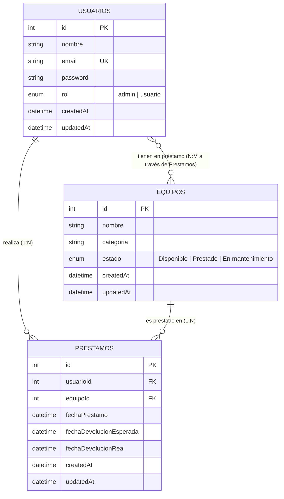

# RedTec - API REST Segura para Gestión de Inventario y Préstamos

> **Trabajo Práctico Integrador:** Desarrollo de API REST Segura  
> **Organización:** RedTec (Centro de Recursos Comunitarios)  
> **Tecnologías:** Node.js, Express, Sequelize ORM, MySQL/MariaDB, JWT, Bcrypt, Bootstrap 5.

---

## 1. Contexto del Problema y Solución

La organización comunitaria **RedTec** gestiona un centro de recursos compartidos (equipos audiovisuales, herramientas especializadas y computadoras portátiles) para apoyar proyectos sociales. 
Anteriormente, los préstamos se administraban manualmente en cuadernos, lo que provocaba pérdidas de equipos, falta de trazabilidad, préstamos indebidos de equipos en mal estado y acumulación de retrasos sin consecuencias.

Esta solución implementa una **API REST robusta, segura y escalable** con persistencia en MySQL a través de **Sequelize ORM**, respaldada por una interfaz web responsiva en Bootstrap.

### Reglas de Negocio Implementadas en el Núcleo:
1. **Límite de Préstamos:** Un usuario regular no puede tener más de **2 equipos prestados simultáneamente**.
2. **Disponibilidad Estricta:** Un equipo no puede ser prestado si su estado en la base de datos es `En mantenimiento` o `Prestado`. La consulta se realiza dentro de una transacción con bloqueo de fila (`LOCK.UPDATE`) para evitar condiciones de carrera (*race conditions*).
3. **Sanción Automática por Mora:** Un middleware personalizado evalúa en tiempo real si el usuario solicitante tiene préstamos cuya fecha esperada de devolución ya venció (`fechaDevolucionReal: null` y `fechaDevolucionEsperada < NOW()`). De existir mora, la API deniega inmediatamente la solicitud con código HTTP **`403 Forbidden`**.

---

## 2. Modelo de Datos y Relaciones

El diseño de la base de datos cumple estrictamente con el estándar relacional exigido:



* **Relaciones 1:N:**  
  * `Usuario 1:N Prestamos` (Un usuario tiene muchos préstamos).  
  * `Equipo 1:N Prestamos` (Un equipo puede figurar en múltiples registros históricos de préstamos).
* **Relación N:M:**  
  * `Usuarios N:M Equipos` materializada mediante la tabla intermedia `Prestamos`, la cual almacena atributos propios del evento (fechas de inicio, compromiso y devolución efectiva).

---

## 3. Arquitectura del Proyecto

```
RedTec/
├── .env.example              # Plantilla de variables de entorno
├── .gitignore                # Exclusión de node_modules, .env y logs
├── .sequelizerc              # Configuración de rutas para Sequelize CLI
├── package.json              # Dependencias y scripts del proyecto
├── README.md                 # Documentación técnica completa
├── postman_collection.json   # Colección exportada de pruebas API
├── src/
│   ├── app.js                # Punto de entrada Express y middlewares globales
│   ├── config/
│   │   └── database.js       # Configuración de Sequelize conectada a .env
│   ├── models/
│   │   ├── index.js          # Inicialización y mapeo de asociaciones
│   │   ├── Usuario.js        # Modelo de Usuario con hashing bcrypt
│   │   ├── Equipo.js         # Modelo de Equipo e inventario
│   │   └── Prestamo.js       # Modelo intermedio de Préstamos
│   ├── migrations/           # Scripts reproducibles de migración DDL
│   ├── seeds/                # Semillas con datos de prueba (Admin, usuarios, equipos)
│   ├── routes/
│   │   ├── auth.routes.js    # Registro y login
│   │   ├── equipos.routes.js # CRUD de inventario
│   │   └── prestamos.routes.js # Solicitudes y devoluciones
│   ├── controllers/
│   │   ├── auth.controller.js
│   │   ├── equipos.controller.js
│   │   └── prestamos.controller.js
│   └── middlewares/
│       ├── auth.middleware.js       # Verificación de JWT
│       ├── role.middleware.js       # Control de acceso por roles (soloAdmin)
│       ├── validator.middleware.js  # Validaciones con express-validator
│       ├── mora.middleware.js       # Regla 3: Detección y bloqueo por mora
│       └── limite.middleware.js     # Regla 1: Límite máximo de 2 préstamos activos
└── public/                          # Frontend ligero en Bootstrap 5
    ├── index.html                   # Interfaz de usuario y catálogo
    ├── css/style.css                # Estilos visuales
    └── js/app.js                    # Consumo interactivo de la API REST
```

---

## 4. Instalación y Puesta en Marcha

### Prerrequisitos
* **Node.js** (v18 o superior)
* **MySQL** o **MariaDB** ejecutándose en el puerto 3306

### Pasos de Configuración:

1. **Clonar el repositorio y entrar a la carpeta:**
   ```bash
   cd RedTec
   ```

2. **Instalar dependencias:**
   ```bash
   npm install
   ```

3. **Configurar Variables de Entorno:**
   Copia el archivo `.env.example` a `.env` y ajusta las credenciales de tu base de datos:
   ```bash
   cp .env.example .env
   ```
   Variables requeridas en `.env`:
   ```env
   PORT=3000
   NODE_ENV=development
   DB_HOST=127.0.0.1
   DB_PORT=3306
   DB_NAME=redtec_db
   DB_USER=root
   DB_PASSWORD=tu_password
   JWT_SECRET=clave_secreta_jwt_redtec_2026
   JWT_EXPIRES_IN=2h
   CLIENT_ORIGIN=http://localhost:3000
   ```

4. **Crear la Base de Datos:**
   Asegúrate de que la base de datos `redtec_db` exista en tu gestor MySQL/MariaDB:
   ```sql
   CREATE DATABASE IF NOT EXISTS redtec_db CHARACTER SET utf8mb4 COLLATE utf8mb4_unicode_ci;
   ```

5. **Ejecutar Migraciones y Seeds:**
   ```bash
   # Ejecuta las migraciones (creación de tablas)
   npm run migrate

   # Carga los datos iniciales de prueba
   npm run seed

   # O ambos comandos en uno:
   npm run setup:db
   ```

6. **Iniciar el Servidor:**
   ```bash
   # Modo desarrollo (con recarga automática mediante nodemon):
   npm run dev

   # Modo producción:
   npm start
   ```

El servidor estará disponible en: `http://localhost:3000`  
La interfaz web de prueba en Bootstrap se encuentra en: `http://localhost:3000/`

---

## 5. Cuentas de Prueba Pre-cargadas (Seeds)

| Rol | Nombre | Email | Contraseña | Estado / Escenario de Prueba |
| :--- | :--- | :--- | :--- | :--- |
| **Administrador** | Administrador RedTec | `admin@redtec.org` | `Admin123!` | Acceso completo (CRUD equipos, reportes) |
| **Usuario Común** | Carlos Gomez | `carlos@redtec.org` | `Usuario123!` | Tiene 1 préstamo activo (puede pedir 1 más) |
| **Usuario Moroso** | Lucia Silva | `lucia@redtec.org` | `Usuario123!` | Tiene un préstamo vencido (bloqueada con 403) |

---

## 6. Endpoints de la API REST

### Autenticación (`/api/auth`)
* `POST /api/auth/registro` - Registro de nuevos usuarios (rol asignado forzosamente a `usuario`).
* `POST /api/auth/login` - Inicio de sesión con rate-limit defensivo, retorna JWT.
* `GET /api/auth/perfil` - Obtiene los datos del usuario autenticado actual.

### Inventario de Equipos (`/api/equipos`)
* `GET /api/equipos` - Listar todos los equipos (permite filtrar por `?estado=Disponible` y `?categoria=`).
* `GET /api/equipos/:id` - Obtener detalle de un equipo.
* `POST /api/equipos` - Crear equipo *(Solo Administrador)*.
* `PUT /api/equipos/:id` - Actualizar equipo *(Solo Administrador)*.
* `DELETE /api/equipos/:id` - Eliminar equipo *(Solo Administrador)*.

### Préstamos y Devoluciones (`/api/prestamos`)
* `POST /api/prestamos` - Solicitar préstamo *(Aplica validaciones: JWT, mora, límite 2 equipos, disponibilidad y transacción con bloqueo)*.
* `GET /api/prestamos/mis-prestamos` - Listar los préstamos del usuario autenticado.
* `GET /api/prestamos` - Listar todos los préstamos registrados *(Solo Administrador)*.
* `PUT /api/prestamos/:id/devolver` - Registrar devolución del equipo (cambia estado a `Disponible` y guarda fecha real).

---

## 7. Pruebas y Casos de Validación Clave

Se incluye el archivo **`postman_collection.json`** listo para importar en Postman o Thunder Client con los 5 escenarios solicitados:
1. **Límite de préstamos:** Un usuario con 2 equipos activos recibe `400 Bad Request` al solicitar un tercero.
2. **Sanción por mora:** Lucia (`lucia@redtec.org`) intenta pedir un equipo y recibe `403 Forbidden` por préstamo vencido.
3. **Disponibilidad:** Intentar solicitar un equipo en estado `Prestado` o `En mantenimiento` devuelve error de conflicto.
4. **Autorización RBAC:** Un usuario regular intentando crear o borrar un equipo recibe `403 Forbidden`.
5. **Admin:** El administrador puede gestionar inventario y visualizar auditoría de préstamos sin restricciones.
